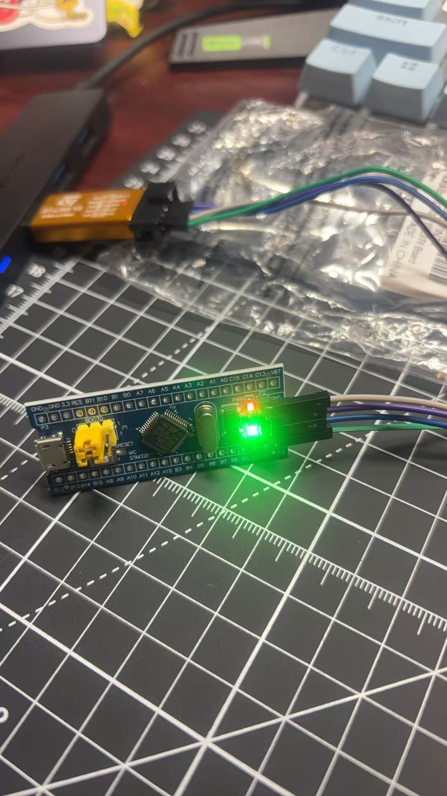

# Lesson 01: Toolchain setup and first blinking LED

**Date:** 2026-10-20 · **Code:** [`blink/`](../blink/)



## Goal

Set up the STM32 toolchain from scratch, connect an ST-Link programmer to a Blue Pill board, and run my first program: blinking the on-board LED on pin PC13.

## What I did

1. **Configured the chip in STM32CubeMX** (STM32F103C8T6, LQFP48):
   - `SYS → Debug = Serial Wire`, which keeps PA13 (SWDIO) and PA14 (SWCLK) reserved so the programmer can always reach the chip
   - `PC13 = GPIO_Output`
   - Generated a project for STM32CubeIDE
2. **Imported the project into STM32CubeIDE 2.2.0** and added the blink loop inside `while (1)`:
   ```c
   HAL_GPIO_TogglePin(GPIOC, GPIO_PIN_13);
   HAL_Delay(500);
   ```
3. **Built the project:** 0 errors, 0 warnings. The program uses about 4.6 KB of the 64 KB flash and 1.6 KB of the 20 KB RAM.
4. **Wired the ST-Link to the Blue Pill's SWD header** with four female-to-female jumpers:

   | ST-Link pin | Signal | Blue Pill pin |
   |---|---|---|
   | 2 | SWCLK | DCLK |
   | 4 | SWDIO | DIO |
   | 6 | GND | GND |
   | 8 | 3.3V | 3V3 |

5. **Flashed the board.** The console printed `Download verified successfully`. I changed the delay from 500 ms to 100 ms and flashed again. The LED blinked faster, which confirmed my own program was running and not the factory demo.
6. **Tried a pattern:** three quick blinks, then a one-second pause.

## Problems I ran into and how I fixed them

| Problem | Cause | Fix |
|---|---|---|
| Couldn't find the pin configurator inside CubeIDE | Since CubeIDE 2.0, CubeMX is a separate tool | Configured in standalone CubeMX, generated for STM32CubeIDE, then imported the project |
| CubeMX asked to download a firmware package | The STM32F1 HAL package wasn't installed yet | Downloaded STM32Cube FW_F1 V1.8.7 |
| Not sure which ST-Link pins were which | The 10-pin header is labeled only on the case | Found pin 1 using the triangle mark. All four signals I needed are on the even-numbered row. GND and 3.3V appear on both rows, so a row mix-up couldn't damage anything |
| Firmware upgrade said "ST-Link is not in DFU mode" | The ST-Link was plugged into a USB hub | Plugged it directly into the laptop and upgraded the firmware to V2J48S7 |
| Run configuration defaulted to "Connect under reset" | That mode needs a reset (NRST) wire, which the Blue Pill's 4-pin SWD header doesn't have | Changed Reset behaviour to "Software system reset" |
| The three-blink pattern looked inverted: the LED stayed on during the pause | The PC13 LED is **active-low**: it's wired between 3.3V and the pin, so it lights when the pin outputs 0 | Learned that I should set the level explicitly with `HAL_GPIO_WritePin` instead of toggling |

## What I learned

- The basic embedded workflow: configure → generate → write code → build → flash → test
- How SWD programming works and which four signals it needs
- How to read a programmer's pinout and wire it safely
- **Active-low outputs:** current only flows when there is a voltage difference across the LED, so pin = 0 means LED on
- How to read the build size report (flash vs RAM usage)

## Next

Lesson 02: GPIO internals (push-pull vs open-drain), switching the system clock to 72 MHz with the external crystal, and writing small LED helper functions.
