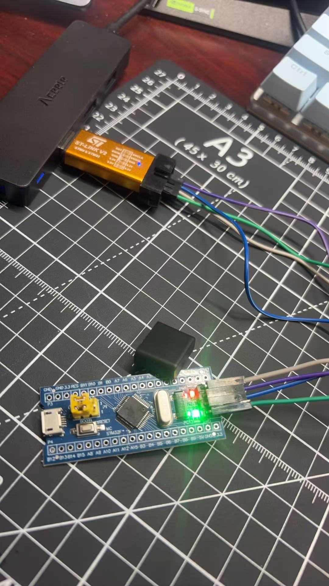

# Lesson 03: Non-blocking timing with HAL_GetTick

**Date:** 2026-10-23 · **Code:** [`blink/`](../blink/) · **Video:** [non-blocking SOS](../media/lesson-03-sos-nonblocking.mp4) · **Screenshot:** [variables read in the debugger](../media/lesson-03-expressions.png)



## Goal

Stop the program from sitting inside `HAL_Delay()`, so it can do several things at once. Later projects will need to sample sensors thousands of times per second while also blinking LEDs and checking buttons, and none of that works if the CPU spends most of its time waiting.

## What I did

1. **Switched PC13 back to push-pull** in CubeMX after the open-drain experiment from lesson 2, then regenerated the code.
2. **Replaced the delay with "check the clock".** `HAL_GetTick()` returns the number of milliseconds since reset. The SysTick timer (set up by `HAL_Init()`) adds 1 to it every millisecond. Instead of waiting 500 ms, every pass of the main loop checks whether 500 ms have passed and, if not, moves on:
   ```c
   uint32_t now = HAL_GetTick();
   if (now - led_last >= 500)
   {
     led_last = now;
     HAL_GPIO_TogglePin(LED_GPIO_Port, LED_Pin);
   }
   ```
   I wrote `now - led_last >= 500` instead of `now >= led_last + 500` on purpose. The tick counter is 32 bits, so it wraps back to 0 after 2³² ms (about 49.7 days). Unsigned subtraction still gives the correct elapsed time across the wrap, while the addition version would break.
3. **Ran two tasks at once and measured how fast the loop runs.** I added a second task that counts seconds, plus a counter for loop passes. Then I ran the program in debug mode, paused it after about 12 seconds, and read the variables in the Expressions view:

   | Variable | Value |
   |---|---|
   | `now` (ms since reset) | 11 846 |
   | `seconds` | 11 |
   | `loop_count` | 10 786 696 |

   `seconds` only counts whole seconds, so I used `now` for the exact time: 10 786 696 ÷ 11.846 s ≈ **910 000 loop passes per second**, about 1.1 µs per pass, or about 79 clock cycles at 72 MHz. This is an unoptimized Debug build. For comparison, the blocking SOS from lesson 2 went around the loop **once every 5.1 seconds**.
4. **Rewrote SOS as a state machine.** The on/off durations live in a table, and an index remembers which step the pattern is on. Even steps are "on", odd steps are "off", and `%` wraps back to step 0 after the last one:
   ```c
   const uint32_t sos[] = {
     150,150, 150,150, 150,450,    // S (last gap is longer: end of letter)
     450,150, 450,150, 450,450,    // O
     150,150, 150,150, 150,1050    // S (last gap is longest: end of word)
   };

   if (now - sos_last >= sos[sos_index])
   {
     sos_last = now;
     sos_index = (sos_index + 1) % SOS_STEPS;
     if (sos_index % 2 == 0) LED_On(); else LED_Off();
   }
   ```
   The LED shows the same SOS as in lesson 2, but now the loop never stops: SOS and the seconds counter run side by side. I left the old blocking version in `main.c` as a comment for comparison.
5. **Checked the timing in a video**, the same way as in lesson 2. I measured the LED frame by frame at 30 frames per second (33 ms per frame):

   | Element | Expected | Measured |
   |---|---|---|
   | Dot (on) | 150 ms | 167–200 ms |
   | Gap inside a letter | 150 ms | 100–133 ms |
   | Dash (on) | 450 ms | 467–500 ms |
   | Gap between letters | 450 ms | 400–433 ms |

   Everything is within one or two frames of the table, so the state machine reproduces the lesson 2 timing without ever blocking.

## Problems I ran into and how I fixed them

| Problem | Cause | Fix / lesson |
|---|---|---|
| Build failed with `Cannot run program "make": Launching failed`, although it worked the day before | Windows 11 **Smart App Control** had started enforcing and blocked the `make.exe` that comes with STM32CubeIDE. The Windows Code Integrity log showed the block at the exact time of my build. The compiler, debugger and ST-Link tools were not blocked | Switched the project to CubeIDE's **internal builder** (Project Properties → C/C++ Build → Builder type), which calls the compiler directly without `make`. Smart App Control stays on |
| The debug session kept ending by itself | I clicked the green ▶ **Run** button to "continue". Run flashes the board again and ends the debug session | Start with Debug As. Use Resume and Suspend (Run menu or the debug toolbar) to continue and pause |
| Couldn't find the Live Expressions view | It wasn't in this CubeIDE version's Show View list | Used the Expressions view. It updates when the program is paused, which was enough for this measurement |
| After editing, the board still blinked the old pattern | The new code had never been built. `blink.elf` was older than `main.c`, so the old program was still on the chip | Build first and check `0 errors` before flashing |
| Build failed with 5 errors | While replacing the old task, I accidentally deleted the `/**` that opens the comment above `SystemClock_Config()`, so the compiler tried to read the comment text as code | Restored `/**`. Start from the first error's line |
| Still 2 errors, with confusing messages | I had also deleted the `}` that closes the SOS `if` block, so the braces no longer matched and the compiler lost track of where `main()` ends | Added the `}` back. CubeIDE highlights the matching brace when the cursor is next to one |

## What I learned

- How `HAL_GetTick()` and the 1 ms SysTick interrupt keep time
- The non-blocking pattern: each task checks the clock, does its work if it's due, and returns right away, so one loop can run many tasks
- Why unsigned subtraction makes the timing code safe when the counter wraps around
- How to write a state machine driven by a table, which I'll reuse for recognizing rhythms in sound
- Measuring with the debugger instead of guessing: about 910 000 loop passes per second
- What `make` does in a build, and that an operating system security policy can break a toolchain
- Reading build errors: one missing `/**` or `}` can cause several confusing errors further down

## Next

Lesson 04: hardware timer interrupts (TIM2), so timing no longer depends on how fast the main loop runs.
