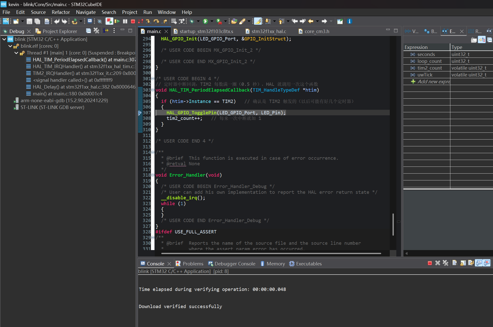

# Lesson 05: Breakpoints, stepping and reading hardware registers

**Date:** 2026-10-31 · **Code:** [`blink/`](../blink/) (no code changes this lesson) · **Video:** [stepping through main() with the board in view](../media/lesson-05-stepping.mp4) · **Screenshots:** [call stack](../media/lesson-05-call-stack.png), [GPIOC ODR](../media/lesson-05-sfr-gpioc-odr.png), [TIM2 registers](../media/lesson-05-sfr-tim2.png)

## Goal

Use the debugger as a measuring tool, not just a pause button: stop at a chosen line, step through code one line at a time, and read and write the hardware registers directly. Also test the open question from lesson 4: why `tim2_count` was one higher than expected.

## What I did

1. **Set a breakpoint inside the interrupt callback** (on `HAL_GPIO_TogglePin` in `HAL_TIM_PeriodElapsedCallback`) and let the program run into it. The call stack showed the whole interrupt chain from lesson 4, which I had only seen as a diagram before:

   

   | Frame (read bottom to top) | What it means |
   |---|---|
   | `main() at main.c:180` | The main loop was at `HAL_Delay(3000)` |
   | `HAL_Delay() at stm32f1xx_hal.c:382` | Waiting inside `HAL_Delay`'s `while` loop |
   | `<signal handler called>() at 0xfffffff9` | The moment the hardware interrupted. `0xFFFFFFF9` is a special return value (EXC_RETURN) that tells the CPU to restore the saved state when the handler finishes |
   | `TIM2_IRQHandler()` | The interrupt vector for TIM2 |
   | `HAL_TIM_IRQHandler()` | HAL checks and clears the update flag |
   | `HAL_TIM_PeriodElapsedCallback() at main.c:307` | My callback, stopped at the breakpoint |

   Each time I pressed Resume, the program ran until the next interrupt and stopped again, and the LED changed state once.
2. **Stepped through `main()` from the start.** Step Over runs a line (including any function it calls), Step Into enters the function, Step Return finishes the current function. What I saw on the board:

   | Point in the code | LED | Why |
   |---|---|---|
   | Before `MX_GPIO_Init()` | Off or very faint | After reset PC13 is a floating input, so nothing drives the pin |
   | After `MX_GPIO_Init()` | Off | PC13 is now an output, starting high |
   | Stepping over `HAL_GPIO_WritePin(..., GPIO_PIN_RESET)` inside `LED_On()` | **On** | That single line pulls PC13 low |
   | Stepping over `HAL_Delay(3000)` in the loop | Blinking | Stepping over that line really runs the CPU for 3 s, and TIM2 interrupts still happen during it |

   Pressing Step Into on `HAL_Init()` took me into the HAL source (`stm32f1xx_hal.c`), so I could follow exactly what the library does.

   I [filmed the screen and the board together](../media/lesson-05-stepping.mp4) while stepping. Measured frame by frame, the LED stays off for the first 11 s while I step through the initialization, and turns on at the step that executes `LED_On()`. In the main loop, every Step Over of `HAL_Delay(3000)` produces a burst of about 3 s with the LED toggling every 500 ms (533 ms on, 467 ms off), and then the LED freezes again while the CPU waits for my next step.
3. **Turned the LED on by writing a register, with the CPU halted.** In the SFRs view, GPIOC's output data register `ODR` is at address `0x4001100C` and read `0x2000`, so only bit 13 was set (PC13 high, LED off). I changed it to `0x0` and the LED turned on immediately, without a single line of code running. `HAL_GPIO_WritePin` ultimately does exactly this: peripherals are controlled by writing numbers to fixed addresses (memory-mapped I/O). The value field wanted hexadecimal input (`0x0`), plain `0` was rejected.
4. **Checked that CubeMX settings really end up in hardware registers.** TIM2's `PSC` was `0x1C1F` (7199) and `ARR` was `0x1387` (4999), exactly the `7200-1` and `5000-1` I entered in lesson 4. `RCC_APB1ENR.TIM2EN = 1` shows the timer's clock is switched on, and `TIM2_CR1 = 0x1` shows the counter is enabled (CEN).
5. **Answered the lesson 4 question.** With the CPU halted the whole time, I re-read TIM2's counter (`CNT`) several times:

   | Read | CNT |
   |---|---|
   | 1 | `0xD6A` (3434) |
   | 2 | `0xE51` (3665) |
   | 3 | `0x7A8` (1960) |
   | 4 | `0xFAD` (4013) |

   The value kept changing, so **TIM2 keeps counting while the core is halted**, while SysTick (which drives `uwTick`) stops. If the timer wraps during a pause, its interrupt is pending, and it runs as soon as I press Resume. That makes `tim2_count` get ahead of `uwTick` by one, which explains the extra count in lesson 4. Then I set `DBGMCU_CR.DBG_TIM2_STOP` to 1 in the SFRs view, and `CNT` stayed at `0x2D` on every read: the timer now freezes together with the CPU. In code, the same setting is `__HAL_DBGMCU_FREEZE_TIM2()`.

   Side note: the four readings look random because the counter wraps every 0.5 s and I read it only every 1–2 s. Sampling slower than the thing you measure loses information. This is the same reason sound has to be sampled at more than twice its highest frequency (Nyquist).

## Problems I ran into and how I fixed them

| Problem | Cause | Fix / lesson |
|---|---|---|
| Double-clicking next to the line number folded the whole function instead of setting a breakpoint | I clicked the code-folding marker on the right of the line numbers | Breakpoints go in the narrow ruler on the far left, or use Ctrl+Shift+B on the line |
| F5 on `HAL_Init()` jumped to "line 152" | F5 is Step Into, so it opened `stm32f1xx_hal.c` and stopped at the first real line of `HAL_Init` | F7 (Step Return) gets back out; F6 (Step Over) stays in `main` |
| The SFRs view wasn't there | The debug session had ended and the IDE was back in the C/C++ perspective | Start a debug session first. SFRs is a debug view |
| Writing `0` to `ODR13` gave "illegal input" | The SFR view expects hexadecimal | Enter `0x0` |
| The RD (read) button was greyed out | RD reads the selected register, and a bit field was selected | Select the register row (e.g. `CNT`) first |

## What I learned

- Breakpoints and the call stack, and how to read a call stack from bottom to top
- Step Over, Step Into and Step Return, and that interrupts still happen while stepping
- Peripherals are memory-mapped registers. HAL functions are a convenient way to write the right bits
- How CubeMX settings (prescaler, period, clock enable) end up as register values
- A debugger halt stops the CPU and SysTick but not necessarily the peripherals, and the DBGMCU freeze bits control this
- Sampling too slowly loses information (aliasing), which will matter when I sample sound

## Next

Lesson 06: solder the header pins at the ECE OpenLab, then start using the breadboard with an external LED (choosing the current-limiting resistor) and a button (pull-up resistor and debouncing).
